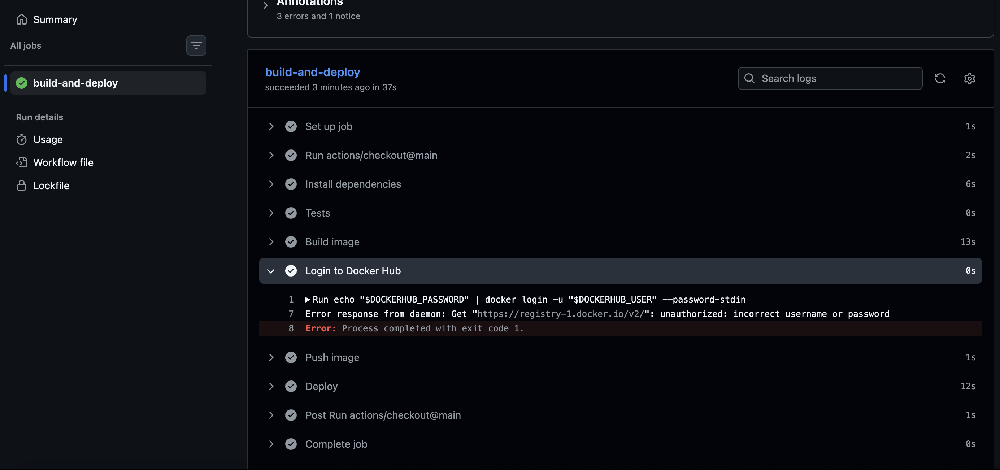
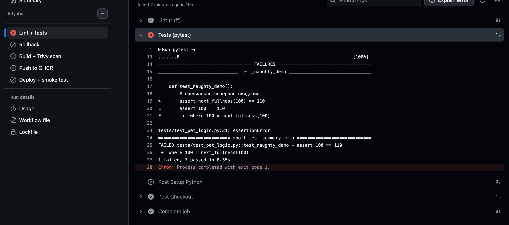
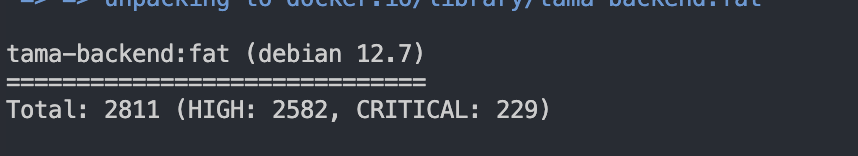
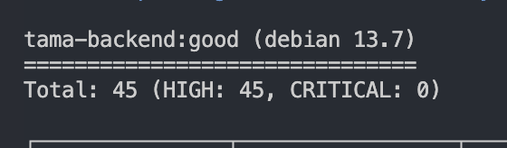
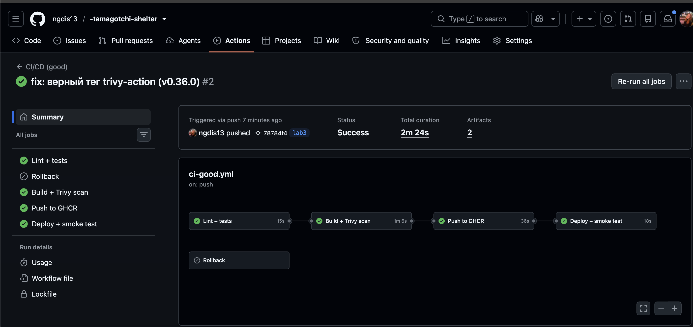
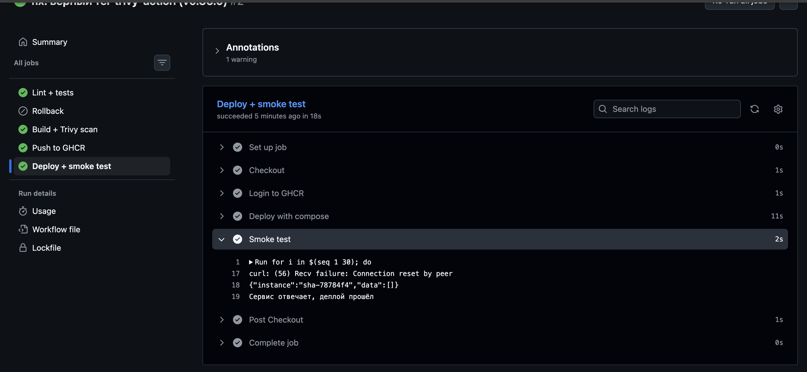
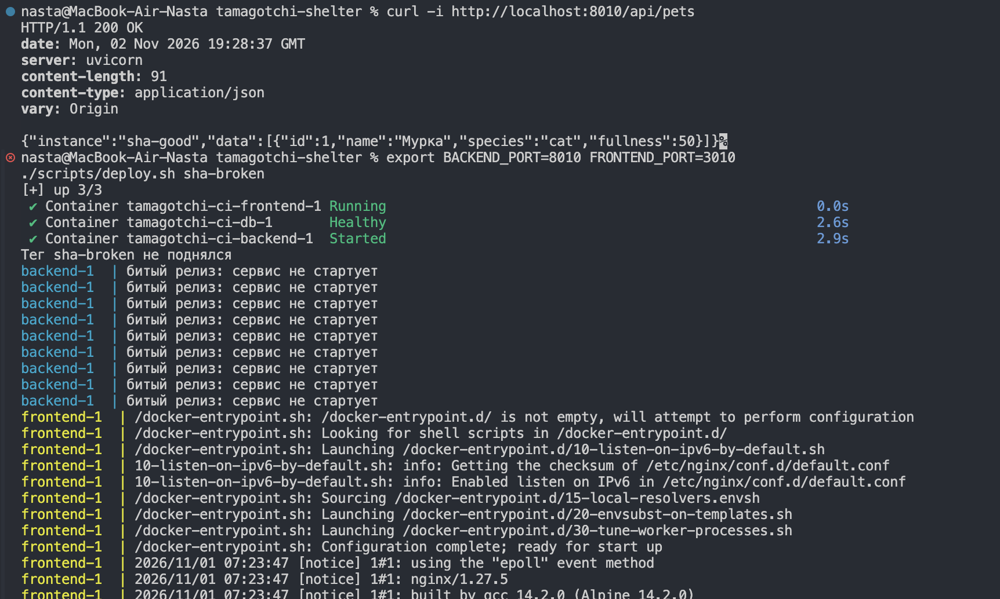
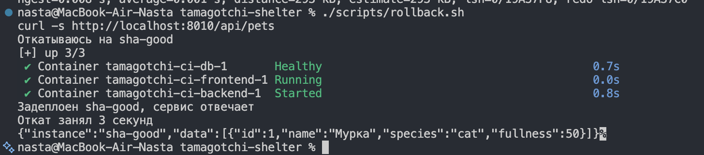

### Отчёт по Лабораторной работе №3 

**Тема:** CI/CD — чтобы плохой код не доехал до прода, а хороший доехал сам

**Репозиторий:** https://github.com/ngdis13/-tamagotchi-shelter (ветка `lab3`)

### Введение

К третьей лабе у меня уже был рабочий приют из Лабы 0, nginx из Лабы 1 и Docker Compose из Лабы 2. Не хватало последнего: чтобы всё это собиралось и проверялось само, без «ой, я забыла прогнать тесты и запушить образ».

Сделала два пайплайна на GitHub Actions:

* [`.github/workflows/ci-bad.yml`](../../.github/workflows/ci-bad.yml) — «плохой», работает, но с кучей bad practices;
* [`.github/workflows/ci-good.yml`](../../.github/workflows/ci-good.yml) — «хороший», где эти практики исправлены.

И главное — показала три результата, которые требует лаба:

1. пайплайн краснеет на плохом коде и **не** деплоит;
2. security-gate на Trivy реально валит сборку на CRITICAL, а после смены базового образа зеленеет;
3. хороший код сам доезжает до «прода», и финальная стадия курлом доказывает, что сервис живой.

Плюс звёздочка — откат на предыдущую версию.

---

### Часть 1. Плохой пайплайн

Полный файл — [`ci-bad.yml`](../../.github/workflows/ci-bad.yml). Запускается вручную (`workflow_dispatch`) или из ветки `ci-bad-demo`, чтобы не мешать обычным пушам.

Коротко, что там происходит:

```yaml
on:
  push:
    branches: [ci-bad-demo]
  workflow_dispatch:

jobs:
  build-and-deploy:
    runs-on: ubuntu-latest
    env:
      DOCKERHUB_USER: ngdis13
      DOCKERHUB_PASSWORD: "SuperSecretPassword123"
    steps:
      - uses: actions/checkout@main
      - run: pip install -r backend/requirements.txt
      - run: pytest -q
        continue-on-error: true
        working-directory: backend
      - run: docker build -t ngdis13/tamagotchi-backend:latest ./backend
      - run: echo "$DOCKERHUB_PASSWORD" | docker login -u "$DOCKERHUB_USER" --password-stdin
      - run: docker push ngdis13/tamagotchi-backend:latest
      - run: docker compose up -d
```

#### Разбор bad practices

| № | Bad practice | Почему плохо |
|---|---|---|
| 1 | Пароль от Docker Hub прямо в `env:` | Он навсегда остаётся в истории git, даже если строку потом удалить. Тот самый «привет Васе» из статьи. |
| 2 | `actions/checkout@main` | Плавающий тег: завтра в `main` положат другое поведение — и пайплайн сломается или, хуже, начнёт делать не то. |
| 3 | `pip install -r requirements.txt` без кеша и без `requirements-dev.txt` | Каждый прогон качает всё заново. И версии в `requirements.txt` не зафиксированы — сборка невоспроизводимая. |
| 4 | `pytest` + `continue-on-error: true` | Самое опасное: тесты упали, а пайплайн зелёный. Ровно так плохой код и уезжает в прод. |
| 5 | `docker build ... :latest` без кеша | Непонятно, какой коммит внутри образа. Откатиться не на что — `latest` перезаписался. |
| 6 | Нет сканирования образа | Уязвимости никто не смотрит. |
| 7 | Пуш и деплой с любой ветки | Фича-ветка с недоделанным кодом спокойно уезжает «в прод». |
| 8 | Деплой сразу после пуша, без smoke-теста | Сервис может упасть на старте, а пайплайн об этом не узнает. |

Скрин прогона плохого пайплайна:



---

### Часть 2. Хороший пайплайн

Полный файл — [`ci-good.yml`](../../.github/workflows/ci-good.yml). Стадии идут цепочкой через `needs`, поэтому деплой физически не может начаться раньше тестов и скана.

```
lint/test  →  build  →  scan (Trivy)  →  push (GHCR)  →  deploy  →  smoke test
```

#### Что исправлено

| Было (плохо) | Стало (хорошо) |
|---|---|
| `checkout@main` | `actions/checkout@v4.2.2`, `setup-python@v5.4.0`, `build-push-action@v6.10.0`, `trivy-action@v0.36.0` — всё по версиям |
| Пароль в yaml | `${{ secrets.GITHUB_TOKEN }}`, в yaml секретов нет вообще |
| Нет кеша | `cache: pip` + `cache-dependency-path` в `setup-python`; `cache-from/to: type=gha` для Docker-слоёв |
| Тесты не блокируют деплой | `continue-on-error` нет, упавший `ruff` или `pytest` останавливает всю цепочку |
| Нет скана | Trivy с `severity: CRITICAL`, `exit-code: 1` — падает на CRITICAL |
| `:latest` | Тег `sha-<короткий коммит>` + `latest`, поэтому есть на что откатиться |
| Деплой с любой ветки | `if: github.event_name == 'push'` + ветки `main, lab3` |
| Нет smoke-теста | Финальный шаг курлит `/api/pets` и падает, если сервис не ответил |
| — | `concurrency: cancel-in-progress: true` — новый пуш отменяет старый прогон |
| — | `permissions:` только `contents: read`, `packages: write`, `security-events: write` |

Ещё добавила нормальные тесты, чтобы стадия `lint-test` была не для галочки:

* [`backend/pet_logic.py`](../../backend/pet_logic.py) — функцию кормления вынесла отдельно от FastAPI;
* [`backend/tests/test_pet_logic.py`](../../backend/tests/test_pet_logic.py) — 5 тестов на логику;
* [`backend/tests/test_api.py`](../../backend/tests/test_api.py) — тесты эндпоинтов с фейковым соединением вместо Postgres;
* [`backend/requirements-dev.txt`](../../backend/requirements-dev.txt) — `pytest==8.3.3`, `ruff==0.6.9` (версии зафиксированы);
* [`backend/ruff.toml`](../../backend/ruff.toml) — конфиг линтера.

Локально всё зелёное:

```bash
cd backend
ruff check .        # All checks passed!
pytest -q           # 7 passed in 2.20s
```

---

### Часть 3. Результат 1 — пайплайн ловит плохой код

Чтобы это показать, специально ломаю тест. Добавляю в `backend/tests/test_pet_logic.py`:

```python
def test_naughty_demo():
    # специально неверное ожидание
    assert next_fullness(100) == 110
```

Коммичу и пушу в `lab3`:

```bash
git add backend/tests/test_pet_logic.py
git commit -m "demo: сломанный тест"
git push origin lab3
```

Что должно произойти: джоба `lint-test` краснеет на `pytest`, джобы `build-scan`, `push` и `deploy` **не запускаются вообще** (у них `needs: lint-test`), то есть в прод ничего не уехало.

Скрин красного прогона (видно, что build/scan/push/deploy — skipped):



После скрина тест убираю обратно:

```bash
git revert --no-edit HEAD
git push origin lab3
```

---

### Часть 4. Результат 2 — security-gate реально работает

#### Сначала «жирный» образ

Специально собрала образ на старом базовом образе — [`backend/Dockerfile.fat`](../../backend/Dockerfile.fat):

```dockerfile
FROM python:3.8
WORKDIR /app
COPY requirements.txt .
RUN pip install -r requirements.txt
COPY main.py pet_logic.py ./
CMD ["uvicorn", "main:app", "--host", "0.0.0.0", "--port", "8000"]
```

`python:3.8` уже не поддерживается, внутри старый Debian с кучей дыр. Собираю и сканирую тем же Trivy, что и в пайплайне (через Docker, чтобы не ставить его в систему — [`scripts/trivy-scan.sh`](../../scripts/trivy-scan.sh)):

```bash
docker build -f backend/Dockerfile.fat -t tama-backend:fat backend
docker run --rm -v /var/run/docker.sock:/var/run/docker.sock \
  aquasec/trivy:0.57.1 image --scanners vuln tama-backend:fat
```

Результат — пайплайн бы упал, потому что в гейте стоит `exit-code: 1`, а CRITICAL тут есть:

```text
tama-backend:fat (debian 12.7)
==============================
Total: 2811 (HIGH: 2582, CRITICAL: 229)
```

Скрипт по умолчанию показывает только CRITICAL и HIGH (`SEVERITY=CRITICAL,HIGH`), иначе таблица растягивается на 13 тысяч строк.

Скрин скана жирного образа:



#### Потом починила

Базовый образ взяла свежий и лёгкий — `python:3.12-slim` (он уже был в [`backend/Dockerfile`](../../backend/Dockerfile) из Лабы 2). Пересобрала и просканировала:

```bash
docker build -f backend/Dockerfile -t tama-backend:good backend
docker run --rm -v /var/run/docker.sock:/var/run/docker.sock \
  aquasec/trivy:0.57.1 image --scanners vuln tama-backend:good
```

```text
tama-backend:good (debian 13.7)
===============================
Total: 45 (HIGH: 45, CRITICAL: 0)
```

#### Таблица до / после

| Образ | Базовый слой | CRITICAL | HIGH | Размер |
|---|---|---|---|---|
| `tama-backend:fat` | `python:3.8` (Debian 12.7) | **229** | **2582** | 1.5 GB |
| `tama-backend:good` | `python:3.12-slim` (Debian 13.7) | **0** | **45** | 250 MB |

Числа немного плавают от запуска к запуску: Trivy каждый раз тянет свежую базу CVE, поэтому total может отличаться на десяток-другой. Важна не точная цифра, а разница: 229 CRITICAL против 0 и 2582 HIGH против 45.

Про `ignore-unfixed: true`: я проверяла через `--format json`, у HIGH в хорошем образе нет `FixedVersion`, то есть обновлять там просто нечего. Поэтому гейт падает на том, что реально можно починить, и не краснеет вечно из-за CVE, которого ещё нет в репозитории Debian. CRITICAL при этом ловится как надо: на `fat` 229, на `good` 0.

Примеры того, что ловил Trivy на старом образе (все из-за `imagemagick`, который притащился в базовый слой):

```text
CVE-2025-53014  imagemagick  8:6.9.11.60+dfsg-1.6+deb12u2  →  8:6.9.11.60+dfsg-1.6+deb12u4
CVE-2025-53101  imagemagick  8:6.9.11.60+dfsg-1.6+deb12u2  →  8:6.9.11.60+dfsg-1.6+deb12u4
CVE-2026-23876  imagemagick  8:6.9.11.60+dfsg-1.6+deb12u2  →  8:6.9.11.60+dfsg-1.6+deb12u6
CVE-2026-25897  imagemagick  8:6.9.11.60+dfsg-1.6+deb12u2  →  8:6.9.11.60+dfsg-1.6+deb12u7
```

Что именно чинила:

1. убрала старый `python:3.8`, взяла `python:3.12-slim`;
2. оставила multi-stage сборку из Лабы 2 (в финальный образ не попадают компиляторы и кеш pip);
3. ничего не `apt-get install`-ила лишнего, поэтому в `slim` просто нет `imagemagick` и половины системных пакетов, которые и давали CVE.

Скрин зелёного скана:



---

### Часть 5. Результат 3 — хороший код доезжает сам

После фикса теста пайплайн зелёный, и происходит вот что:

1. `lint-test` — `ruff` + `pytest` прошли;
2. `build-scan` — образ собрался с кешем `type=gha`, Trivy не нашёл CRITICAL;
3. `push` — образ уехал в GHCR с двумя тегами: `sha-<коммит>` и `latest`;
4. `deploy` — [`docker-compose.ci.yml`](../../docker-compose.ci.yml) поднял db + backend + frontend, где backend берётся готовым образом из GHCR;
5. `smoke test` — курл на живой сервис.

Скрин зелёного прогона:



А вот вывод финальной стадии — тот самый живой сервис:



Вывод финальной стадии из самого пайплайна:

```text
{"instance":"sha-78784f4","data":[]}
Сервис отвечает, деплой прошёл
```

`data` пустой, потому что на раннере база поднимается с нуля — это нормально, главное что сервис ответил и вернул свой `instance`.

`instance` — это `APP_INSTANCE_ID`, в [`docker-compose.ci.yml`](../../docker-compose.ci.yml) туда подставляется тег образа. То есть по ответу API сразу видно, какая версия сейчас задеплоена. Удобно.

Проверка, что данные реально в базе и переживают пересоздание контейнера (том `pgdata_ci`):

```bash
curl -s -X POST -H 'Content-Type: application/json' \
  -d '{"name":"Мурка","species":"cat"}' http://localhost:8010/api/pets
# {"id":1,"name":"Мурка","species":"cat","fullness":50}

docker compose -f docker-compose.ci.yml restart backend
curl -s http://localhost:8010/api/pets
# {"instance":"sha-good","data":[{"id":1,"name":"Мурка","species":"cat","fullness":50}]}
```

Про деплой на свою машину: в пайплайне `deploy` крутится на `ubuntu-24.04`, то есть «прод» — это раннер. Если хочется деплоить прямо на свой ноут, достаточно поменять на `runs-on: self-hosted` и зарегистрировать runner. Схема от этого не меняется.

---

### Часть 6. Со звёздочкой — откат (rollback)

#### Как устроено версионирование

* каждый образ тегируется по коммиту: `ghcr.io/ngdis13/tamagotchi-backend:sha-78784f4`;
* `latest` — просто указатель на последний, на него не рассчитываю;
* [`scripts/deploy.sh`](../../scripts/deploy.sh) при деплое сохраняет теги в `.deploy/current_tag` и `.deploy/previous_tag`;
* [`scripts/rollback.sh`](../../scripts/rollback.sh) читает `previous_tag` и деплоит его одной командой, заодно замеряет время.

В самом пайплайне для этого есть отдельная джоба `rollback`, которая запускается вручную (`Run workflow`) с параметром `rollback_to`.

#### Демонстрация «сломали → откатили → снова живой»

Битую версию сделала честно — [`backend/Dockerfile.broken`](../../backend/Dockerfile.broken), контейнер падает на старте:

```dockerfile
CMD ["python", "-c", "raise SystemExit('битый релиз: сервис не стартует')"]
```

Сначала на «проде» нормальная версия:

```bash
export BACKEND_PORT=8010 FRONTEND_PORT=3010
./scripts/deploy.sh sha-good
# Задеплоен sha-good, сервис отвечает
```

Теперь заливаю битую:

```bash
./scripts/deploy.sh sha-broken
# Container tamagotchi-ci-backend-1 Recreated
# backend-1  | битый релиз: сервис не стартует
# Тег sha-broken не поднялся
# --- битый деплой завершился с кодом 1 ---
```

Сервис лежит, smoke test это поймал. Откатываюсь:

```bash
./scripts/rollback.sh
# Откатываюсь на sha-good
# Задеплоен sha-good, сервис отвечает
# Откат занял 3 секунд
```

Проверяю, что всё снова работает:

```bash
curl -s http://localhost:8010/api/pets
# {"instance":"sha-good","data":[{"id":1,"name":"Мурка","species":"cat","fullness":50}]}
```

Скрины до и после:





**Сколько занял откат: 3 секунды.** Это и есть смысл звездочки — не чинить прод в панике руками, а вернуть предыдущий рабочий тег одной командой.

Схема отката коротко:

```
push в lab3
   └─ build ─► scan ─► push :sha-<commit> (+latest)
                          └─ deploy → .deploy/current_tag = sha-<commit>
                                      previous_tag = sha-<предыдущий>

что-то сломалось
   └─ ./scripts/rollback.sh  →  IMAGE_TAG=sha-<предыдущий> docker compose up -d
```

---

### Какие файлы добавила

| Файл | Зачем |
|---|---|
| [`.github/workflows/ci-bad.yml`](../../.github/workflows/ci-bad.yml) | плохой пайплайн (8 bad practices) |
| [`.github/workflows/ci-good.yml`](../../.github/workflows/ci-good.yml) | хороший пайплайн: lint → build → scan → push → deploy → smoke |
| [`docker-compose.ci.yml`](../../docker-compose.ci.yml) | деплой готового образа из GHCR (отдельное имя проекта `tamagotchi-ci`) |
| [`backend/Dockerfile.fat`](../../backend/Dockerfile.fat) | «жирный» образ для демонстрации security-gate |
| [`backend/Dockerfile.broken`](../../backend/Dockerfile.broken) | битый релиз для демонстрации отката |
| [`backend/pet_logic.py`](../../backend/pet_logic.py) | чистая логика кормления, которую тестируем |
| [`backend/tests/`](../../backend/tests) | 7 тестов (логика + API) |
| [`backend/requirements-dev.txt`](../../backend/requirements-dev.txt) | pytest и ruff с фиксированными версиями |
| [`backend/ruff.toml`](../../backend/ruff.toml) | конфиг линтера |
| [`scripts/trivy-scan.sh`](../../scripts/trivy-scan.sh) | локальный Trivy через Docker |
| [`scripts/deploy.sh`](../../scripts/deploy.sh) | деплой тега + smoke test |
| [`scripts/rollback.sh`](../../scripts/rollback.sh) | откат на предыдущий тег с замером времени |

Мелочь по Лабе 2: в [`backend/Dockerfile`](../../backend/Dockerfile) поменяла `COPY main.py .` на `COPY main.py pet_logic.py ./`, иначе новый модуль не попадал в образ и контейнер падал с `ModuleNotFoundError`. Это, кстати, тоже показательно — пайплайн бы такое поймал smoke-тестом.

### Выводы

* Плохой пайплайн удобен ровно до первого инцидента: `continue-on-error` на тестах и `:latest` означают, что в прод уедет что угодно и откатиться будет некуда.
* Хороший пайплайн отличается не «красотой», а тем, что он **блокирует**: красный `pytest` останавливает `needs`-цепочку, а Trivy валит сборку на CRITICAL.
* Security-gate работает: 229 CRITICAL на `python:3.8` против 0 на `python:3.12-slim`, и пайплайн это видит.
* Откат — это отдельная возможность, а не «ну потом поправлю»: тег по коммиту + скрипт на 3 секунды.
